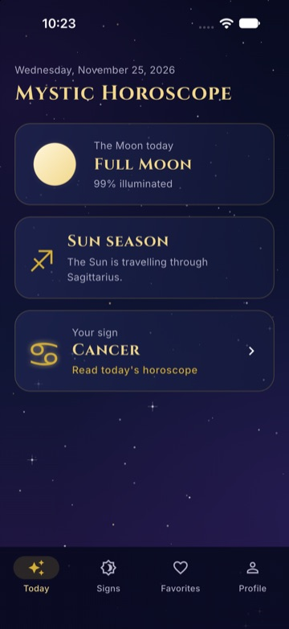
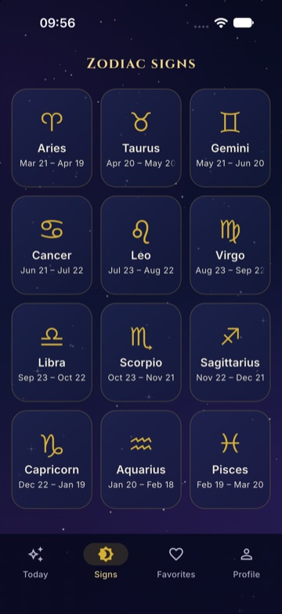
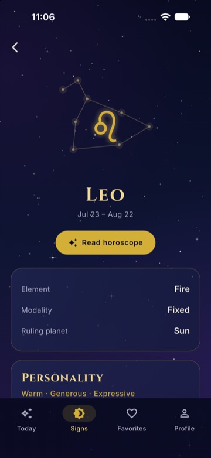
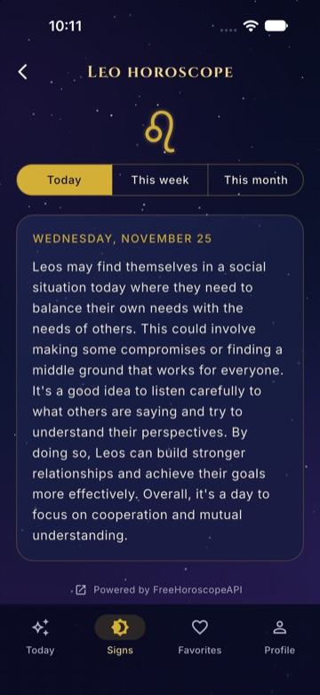
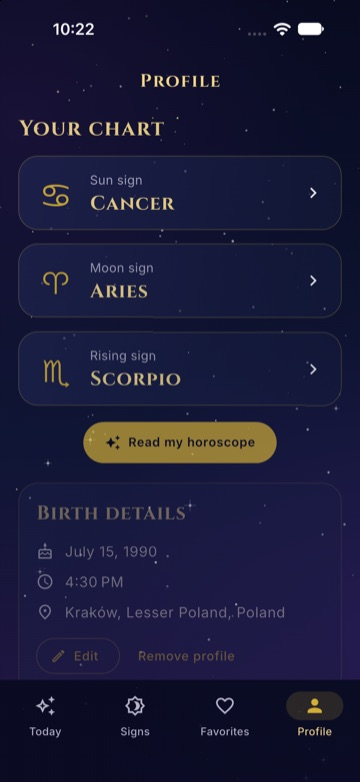
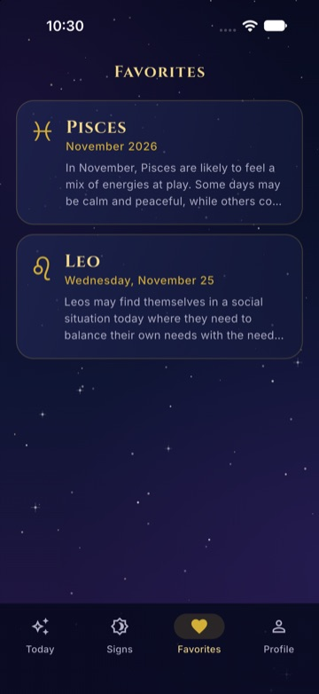

# Mystic Horoscope

A free, ad-free astrology app for iOS and Android built with Flutter:
daily, weekly and monthly horoscopes for all twelve signs, sign profiles,
a personal astrological profile (Sun, Moon and Rising sign) and saved
favorites, wrapped in an animated night-sky design.

<p>
  
  
  
  
  
  
</p>

## Features

### Implemented

| Area | What works |
|---|---|
| Horoscopes | Daily, weekly and monthly readings for all 12 signs from [FreeHoroscopeAPI](https://freehoroscopeapi.com) (live, key-less). Offline cache, stale-copy notice, pull to refresh, retry on errors. |
| Zodiac | All 12 signs with glyph, dates, element, modality, ruler, personality portrait and an animated constellation. |
| Profile | Birth date (required), time and place (optional). Sun, Moon and Rising sign computed on device. Missing data gives honest results such as "Pisces or Aries" instead of a guess. Stored only on the device. |
| Birthplace search | Offline search over 34,246 cities (GeoNames) with historical time zones. |
| Favorites | Save a reading as a snapshot, list it newest first, swipe to delete with undo. Stored on the device. |
| Today | Date, computed Moon phase, current Sun season and your sign's horoscope. |
| Design | Dark navy/violet theme with gold accents, a twinkling star field, constellation drawing, Hero transitions and staggered card entrances. All animations honour the OS "reduce motion" setting. |
| Localization | Flutter gen_l10n. English is the only shipped language; any other device language falls back to English. |

### Not implemented (deliberately postponed)

| Area | Status / reason |
|---|---|
| Yearly horoscope, love/career/money/health | The provider doesn't offer them, so they are not shown. |
| Polish UI and content | The provider is English-only. The UI is ready for `app_pl.arb`. |
| Registration, login, sync | Planned with Firebase Auth and Firestore on the free Spark plan. Waiting for a final app id and a Firebase project. |
| Sign in with Apple | Requires a paid Apple Developer account. |
| Daily notifications | Postponed by decision. Planned as local notifications, no server needed. |

## Requirements

| Tool | Version used |
|---|---|
| Flutter | 3.47.7 (stable) |
| Dart | 3.13.5 |
| Xcode | 27.2. iOS plugins resolve via Swift Package Manager, so CocoaPods is not required. |
| Android SDK | 36 |

## Getting started

```bash
flutter pub get          # also generates localizations (flutter: generate: true)
flutter run              # pick a simulator/emulator or device
```

No API keys, secrets or environment variables are needed. See
[Configuration](#configuration).

### Builds

```bash
flutter build apk --release --split-per-abi      # Android, ~20–23 MB per ABI
flutter build appbundle --release                # Play Store
flutter build ios --release                      # requires signing
```

> The app id is still the template default (`com.example.mysticHoroscope`
> on iOS, `com.example.mystic_horoscope` on Android) and release builds are
> signed with the debug key. Both must be changed before publishing.

## Quality checks

```bash
dart format .
flutter analyze
flutter test                                     # 131 unit, bloc, widget and accessibility tests
flutter test integration_test/app_flows_test.dart -d <device-id>
```

Integration tests use the real DI graph and storage, with only the
horoscope provider faked. They cover four flows: reading and saving a
horoscope, an offline error with retry, a cached reading served offline,
and creating a profile with a birthplace.

### Performance measurement

```bash
flutter drive --profile --no-dds \
  --driver=test_driver/integration_test.dart \
  --target=integration_test/performance_test.dart -d <device-id>
# results: build/integration_response_data.json
```

Use a physical device. Emulator raster times are dominated by GPU
emulation and vary several-fold between runs. To run on your own iPhone
without a paid developer account:

1. Open `ios/Runner.xcworkspace` in Xcode.
2. Sign in with your Apple ID: *Settings → Accounts*.
3. Under *Runner → Signing & Capabilities*, choose your *Personal Team*
   and a unique bundle identifier.
4. Run the command above with the iPhone's device id (`flutter devices`).

## Configuration

| Setting | Where | Notes |
|---|---|---|
| Horoscope provider URL | `lib/core/constants/api_constants.dart` | Public and key-less. |
| Provider implementation | `lib/injection_container.dart` → `_initHoroscope` | Swap `FreeHoroscopeApiDataSource` here. See [docs/ARCHITECTURE.md](docs/ARCHITECTURE.md#changing-the-horoscope-provider). |
| City database | `assets/data/cities.tsv` | Rebuild with `tool/build_cities.py`, see [docs/DATA_SOURCES.md](docs/DATA_SOURCES.md#updating-the-city-database). |

**Environment variables:** none. If a provider that needs a key is added
later, keep the key on a server and never in the app (see the data
sources document).

## Documentation

- [docs/ARCHITECTURE.md](docs/ARCHITECTURE.md): layers, modules, state
  management, caching, calculations, animations, testing.
- [docs/DATA_SOURCES.md](docs/DATA_SOURCES.md): provider analysis,
  licences and attribution duties, city data.
- [docs/DEVELOPMENT_LOG.md](docs/DEVELOPMENT_LOG.md): stages and commits.

## Licences and attribution

- Horoscope texts: FreeHoroscopeAPI. A visible *Powered by
  FreeHoroscopeAPI* link is required and shown on every reading.
- City data: © GeoNames, CC BY 4.0. Credited in the birthplace form and
  on the licence page.
- Fonts: Cinzel, Inter and Noto Sans Symbols (subset), SIL OFL 1.1, in
  `assets/licenses/`.
- Sign characteristics are original content written for this app.
